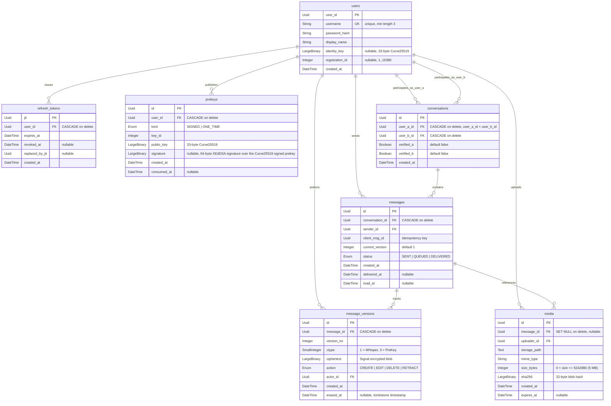

# Nullspace Database Schema

This document details the database architecture, entity relationships, integrity constraints, and cryptographic design invariants for Nullspace.

## Entity-Relationship Diagram

---

## Integrity Constraints

| Constraint Name | Table | Type | Expression / Columns | Description / Purpose |
|---|---|---|---|---|
| `pk_users` | `users` | Primary Key | `user_id` | Unique UUID primary key. |
| `uq_users_username` | `users` | Unique | `username` | Unique username; usernames are stored lowercase, so uniqueness is effectively case-insensitive. |
| `ck_users_username_length` | `users` | Check | `length(username) >= 3` | Enforces minimum username length of 3 characters. |
| `pk_refresh_tokens` | `refresh_tokens` | Primary Key | `jti` | JWT ID unique identifier. |
| `fk_refresh_tokens_user_id_users` | `refresh_tokens` | Foreign Key | `user_id -> users.user_id` | Cascades deletion when user account is deleted. |
| `pk_prekeys` | `prekeys` | Primary Key | `id` | Unique prekey identifier. |
| `fk_prekeys_user_id_users` | `prekeys` | Foreign Key | `user_id -> users.user_id` | Cascades deletion when owner user account is deleted. |
| `uq_prekeys_user_id_kind_key_id` | `prekeys` | Unique | `(user_id, kind, key_id)` | Prevents duplicate key IDs per kind for a user. |
| `ck_prekeys_signature_rule` | `prekeys` | Check | `(kind = 'SIGNED' AND signature IS NOT NULL) OR (kind = 'ONE_TIME' AND signature IS NULL)` | Signed prekeys must have a cryptographic signature; one-time keys must not. |
| `pk_conversations` | `conversations` | Primary Key | `id` | Unique conversation identifier. |
| `fk_conversations_user_a_id_users` | `conversations` | Foreign Key | `user_a_id -> users.user_id` | Cascades deletion when participant A is deleted. |
| `fk_conversations_user_b_id_users` | `conversations` | Foreign Key | `user_b_id -> users.user_id` | Cascades deletion when participant B is deleted. |
| `ck_conversations_ordered_pair` | `conversations` | Check | `user_a_id < user_b_id` | Canonical pair sorting invariant. Eliminates duplicate conversation channels. |
| `uq_conversations_user_a_id_user_b_id` | `conversations` | Unique | `(user_a_id, user_b_id)` | Enforces exactly one conversation per pair of users. |
| `pk_messages` | `messages` | Primary Key | `id` | Unique message identifier. |
| `fk_messages_conversation_id_conversations` | `messages` | Foreign Key | `conversation_id -> conversations.id` | Cascades deletion when conversation is removed. |
| `fk_messages_sender_id_users` | `messages` | Foreign Key | `sender_id -> users.user_id` | Sender reference. |
| `uq_messages_sender_id_client_msg_id` | `messages` | Unique | `(sender_id, client_msg_id)` | Client-generated message UUID ensures idempotent transmission and retries. |
| `pk_message_versions` | `message_versions` | Primary Key | `id` | Unique version identifier. |
| `fk_message_versions_message_id_messages` | `message_versions` | Foreign Key | `message_id -> messages.id` | Cascades deletion when parent message is removed. |
| `fk_message_versions_actor_id_users` | `message_versions` | Foreign Key | `actor_id -> users.user_id` | Actor who performed the create/edit/delete/retract action. |
| `ck_message_versions_ctype_values` | `message_versions` | Check | `ctype IN (1, 3)` | Ciphertext type: `1` (`WhisperMessage` ratchet) or `3` (`PreKeyWhisperMessage` handshake). |
| `uq_message_versions_message_id_version_no` | `message_versions` | Unique | `(message_id, version_no)` | Monotonically ascending version sequence per message. |
| `pk_media` | `media` | Primary Key | `id` | Unique media identifier. |
| `fk_media_message_id_messages` | `media` | Foreign Key | `message_id -> messages.id` | Nullable FK; sets to `NULL` on message deletion (`ON DELETE SET NULL`). |
| `fk_media_uploader_id_users` | `media` | Foreign Key | `uploader_id -> users.user_id` | Account that uploaded the encrypted blob. |
| `ck_media_size_range` | `media` | Check | `0 < size_bytes AND size_bytes <= 5242880` | File attachment size limit (greater than 0 and maximum 5 MB). |
| `ck_media_sha256_length` | `media` | Check | `length(sha256) = 32` | Binary SHA-256 digest of ciphertext blob must be exactly 32 bytes. |

---

## Design Rules

### 1. Ciphertext Only
The Nullspace backend operates under a strict zero-knowledge confidentiality model:
- Every column holding message payloads or cryptographic keys (`message_versions.ciphertext`, `prekeys.public_key`, `prekeys.signature`, `users.identity_key`, `media.sha256`) uses `LargeBinary` (`BYTEA` on PostgreSQL, `BLOB` on SQLite).
- Plaintext columns (such as `body`, `content`, or `text`) are forbidden in `messages` and `message_versions`. The only textual / enum columns permitted in messaging tables are metadata columns (`status` and `action`).
- This invariant is enforced by an automated reflection test in `backend/tests/test_schema.py:test_no_plaintext_columns`.

### 2. Ordered Pair Invariant (`ordered_pair`)
Every direct conversation between two users is governed by `user_a_id < user_b_id`:
- The application guarantees lexicographical sorting of user UUIDs prior to database lookup or creation (`ua, ub = sorted([user1_id, user2_id])`).
- The database enforces `CheckConstraint("user_a_id < user_b_id", name="ordered_pair")` and `UniqueConstraint("user_a_id", "user_b_id")`.
- This ensures exactly one conversation row exists between any two users, eliminating race conditions when two users attempt to start a conversation concurrently.
- Key verification flags are tracked directionally: `verified_a` indicates user A has verified user B's safety number; `verified_b` indicates user B has verified user A's safety number.

### 3. Tombstones and `erased_at`
Nullspace models message lifecycle transitions across four explicit actions (`CREATE`, `EDIT`, `DELETE`, `RETRACT`):
- **Delete Before Read (`DELETE`)**: If the sender deletes a message before the recipient has marked it as read (`read_at IS NULL`), the ciphertext is permanently purged and replaced with empty bytes (`b""`), `erased_at` is set to the current timestamp, and the action is recorded as `DELETE`. The server stores no remaining message data.
- **Retract After Read (`RETRACT`)**: If the sender retracts a message after it has already been delivered and read (`read_at IS NOT NULL`), the server keeps the ciphertext so that both participants can still open the retracted message; retraction means taken back but still visible, unlike DELETE before read, which purges it.

### 4. Why `identity_key` Lives on `users`
The Curve25519 identity key (`0x05` prefix, 33 bytes raw) is stored directly on `users`:
- **Long-term vs Ephemeral Keys**: One-time prekeys are consumed on session initiation, and signed prekeys are rotated periodically. In contrast, the identity key is the user's permanent cryptographic identity.
- **Out-of-band Verification**: Trust On First Use (TOFU), safety number computation (5200 iterations of SHA-512 via libsignal's `FingerprintGenerator`), and key change alerts require direct access to the stable identity public key.
